# Uptime, redesigned

     

A fork of [Uptime Kuma](https://github.com/louislam/uptime-kuma) with a redesigned interface and profile pictures. Monitoring, notifications and status pages work exactly like upstream. What changes is how it looks and reads: a sidebar instead of a top bar, monitors as grouped rows, a detail page with a response time chart and an availability table, and the same dark theme on every screen.

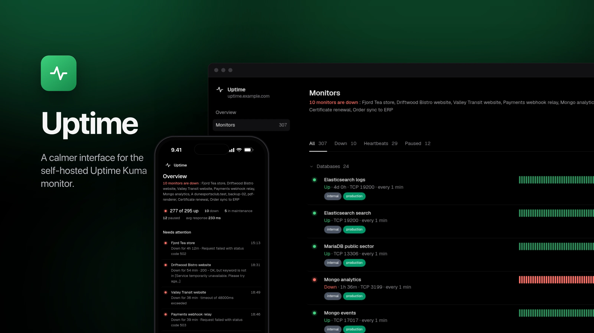

## Why this fork

Uptime Kuma is the best self-hosted uptime monitor there is, but the interface shows its age. Every screen mixes its own cards, badges and green buttons, the important number is rarely the biggest thing on the page, and a monitor that has been down for an hour looks almost the same as one that is fine.

This fork leaves the monitoring alone and redraws the interface around one question: is anything wrong right now, and since when?

* The state comes first. A down monitor is named at the top of every page, with how long it has been down and the error it returned
* Monitors are grouped rows you can scan, filter and select in bulk, with the heartbeat bar, uptime, response time and interval on one line
* The detail page has a response time chart over the whole period, and a table of availability, downtime and incidents for the last 24 hours, 7 days and 30 days
* Settings, forms, maintenance, status pages and dialogs share one layout instead of each having its own
* Empty pages show a public domain engraving and one line on what to do next, instead of "Not available, please set up"
* No slide or fade animations, text contrast of at least 4.5:1, and a visible focus ring for keyboard use

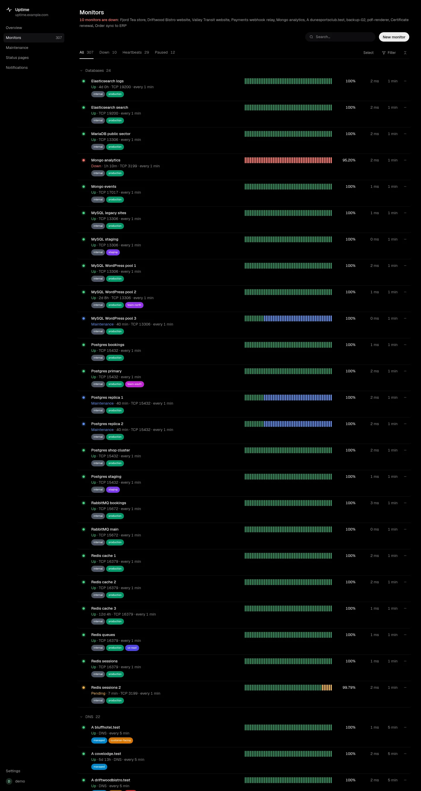

### Monitor detail

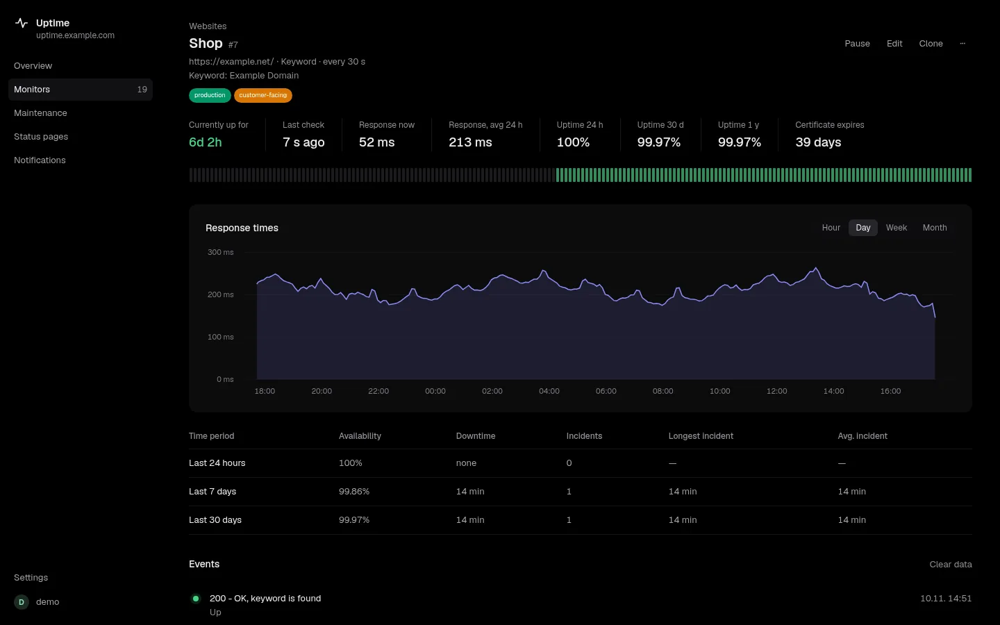

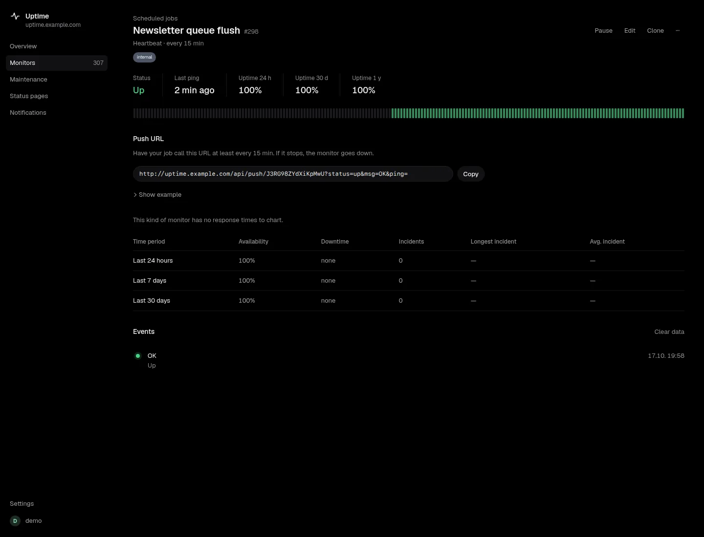

### Filtering and editing

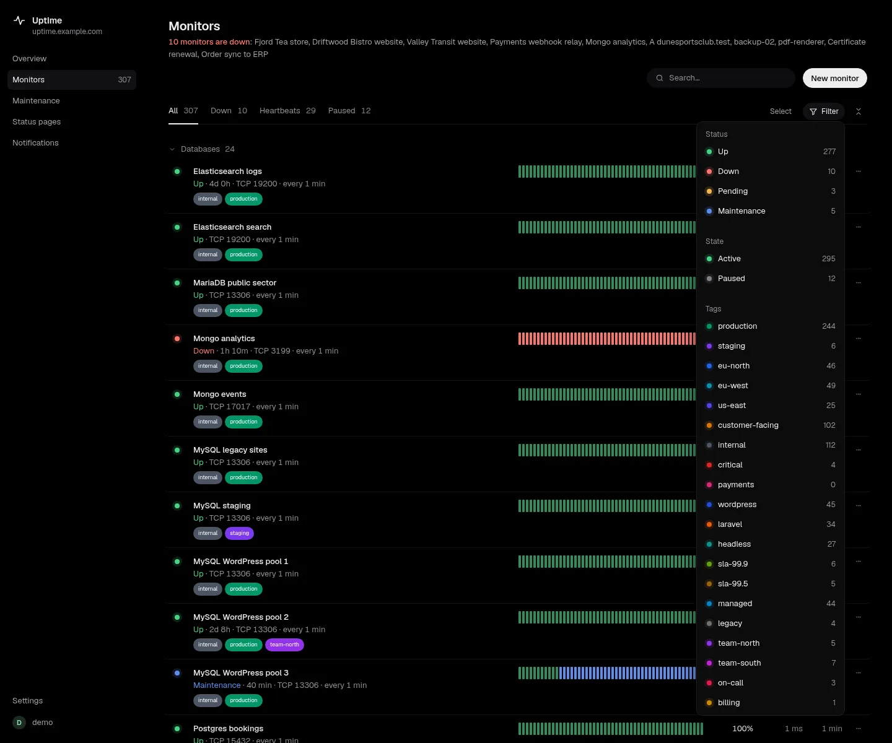

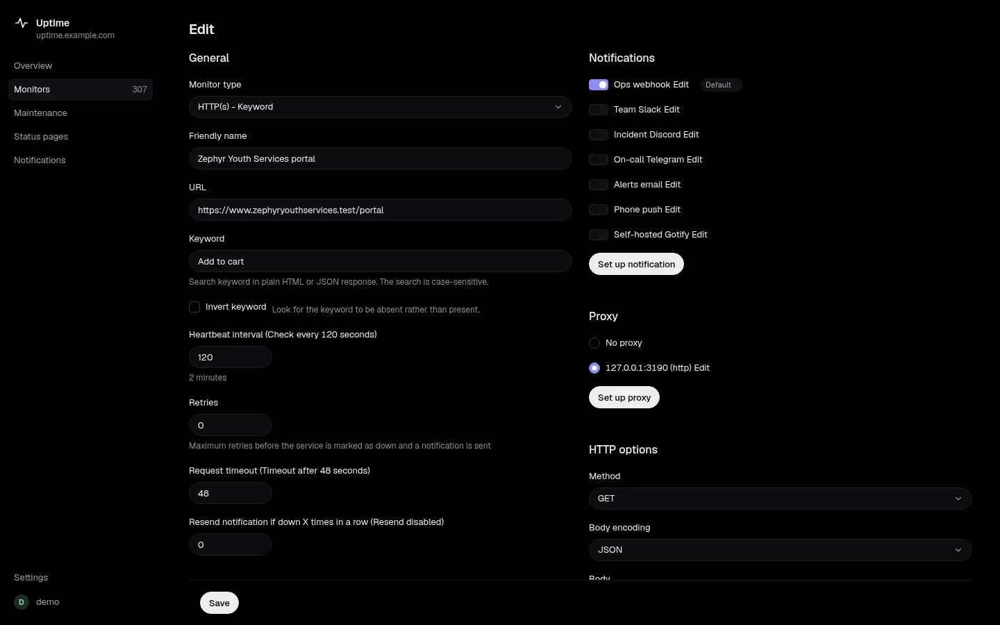

### Settings, maintenance and sign-in

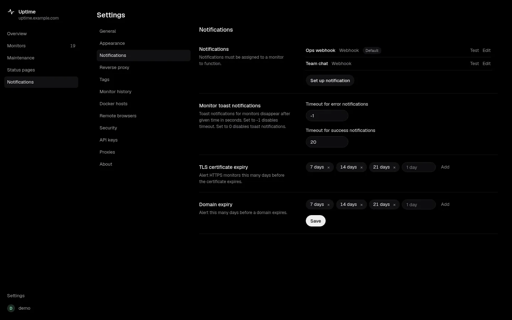

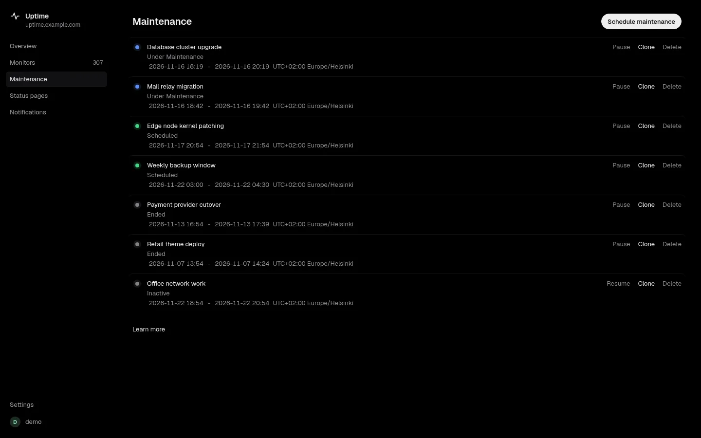

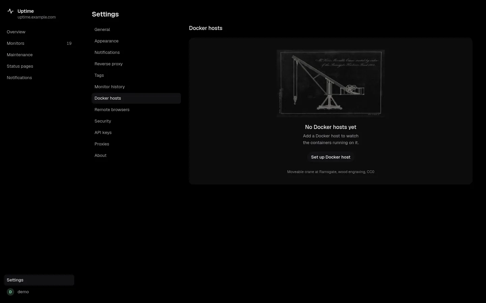

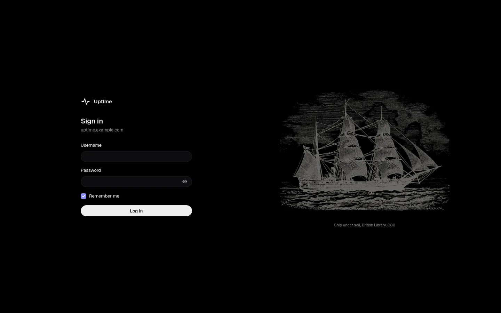

### On a phone

<p>
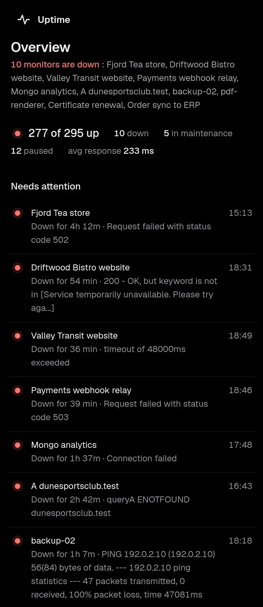
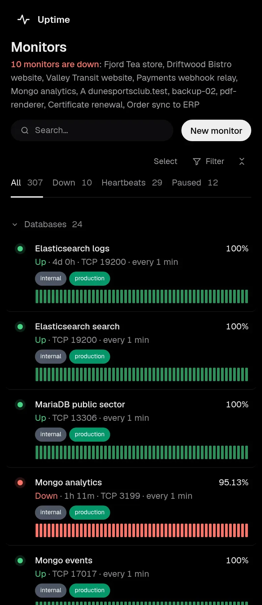
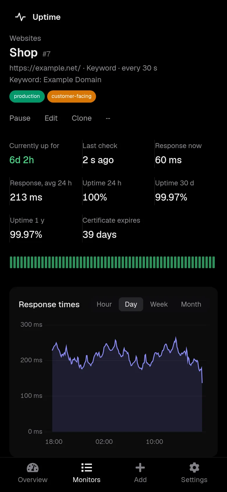
</p>

All screenshots come from a local instance filled with made-up data: 320 monitors in 13 groups with 30 days of history.

## What differs from upstream

* The whole interface is redrawn: layout, monitor list, detail page, settings, forms, maintenance, status page admin, dialogs, sign-in and the 404 page. Public status pages keep the upstream look
* Profile pictures. Upload one under Settings, Security, and it replaces the initial in the sidebar. This is the only server change: a socket handler that stores the picture as a PNG in the upload folder, and a migration that adds an `avatar` column to the `user` table
* Maintenance dates are shown and entered in 24-hour time
* The About page can show the fork version, for example `2.5.11-rolle-f6c203d8`, and the update check ignores the fork suffix
* The interface uses the [Geist](https://vercel.com/font) font, added as `@fontsource-variable/geist`. No other dependencies are added

An existing 2.5.11 installation can move to this fork as it is. The profile picture migration runs on first start, so going back to upstream afterwards means removing that migration from the `knex_migrations` table first.

The same interface on top of upstream `master`, without the profile pictures and the version stamp, is on the [`feat/carbon-ui`](https://github.com/rollecode/uptime-kuma/tree/feat/carbon-ui) branch.

## Running it

There is no prebuilt image. Build the interface, then put it on top of the official 2.5.11 image:

```bash
git clone -b rolle https://github.com/rollecode/uptime-kuma.git
cd uptime-kuma
npm ci
npm run build
docker build -f docker/fork.dockerfile -t uptime-kuma-rolle .
docker run -d --name uptime-kuma -p 3001:3001 -v uptime-kuma:/app/data --restart unless-stopped uptime-kuma-rolle
```

Then open `http://localhost:3001`. To move an existing installation over, stop the old container and start this one with the same data volume.

To stamp the fork version on the About page, build with the version set in both places, so the interface and the server agree:

```bash
VERSION="$(node -p 'require("./package.json").version')-rolle-$(git rev-parse --short HEAD)"
UPTIME_KUMA_VERSION="$VERSION" npm run build
npm pkg set version="$VERSION"
```

Without Docker, run `node server/server.js` after `npm ci` and `npm run build`, with Node.js 20.4 or newer.

## Credits

Uptime Kuma is made by [Louis Lam](https://github.com/louislam) and [its contributors](https://github.com/louislam/uptime-kuma/graphs/contributors). All of the monitoring, notifications and status pages are theirs. If you use it, consider [sponsoring the project](https://github.com/sponsors/louislam).

The engravings on the empty pages and the sign-in page are public domain, several of them from the British Library. Each one is credited under its picture.

## License

MIT, same as [upstream](https://github.com/louislam/uptime-kuma/blob/master/LICENSE). See [LICENSE](LICENSE).
